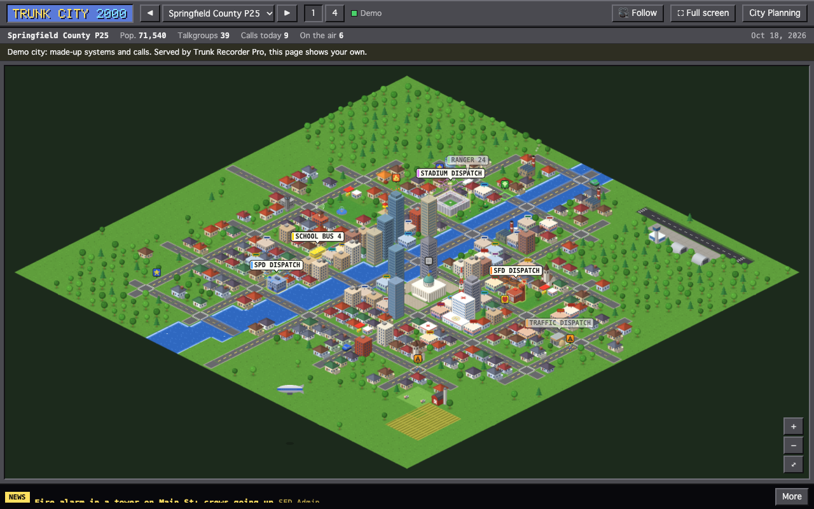
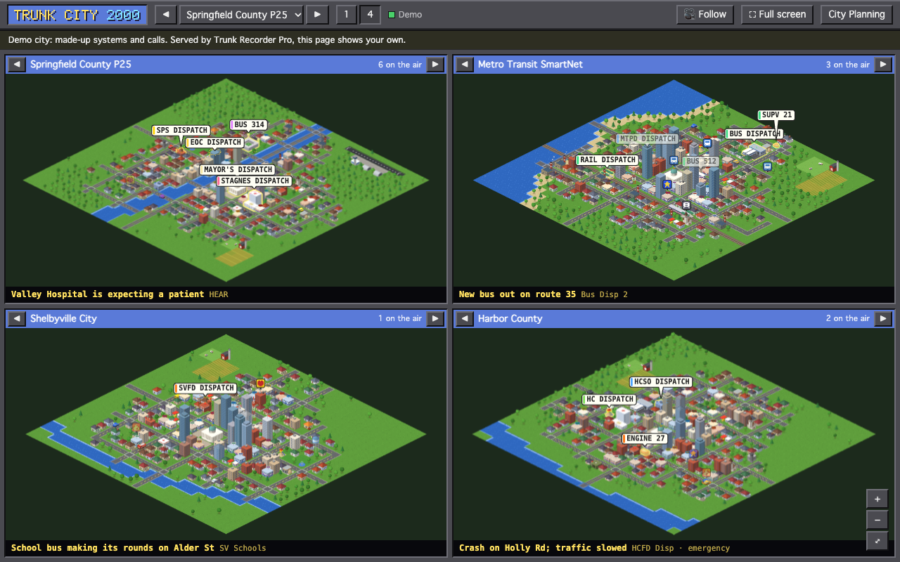
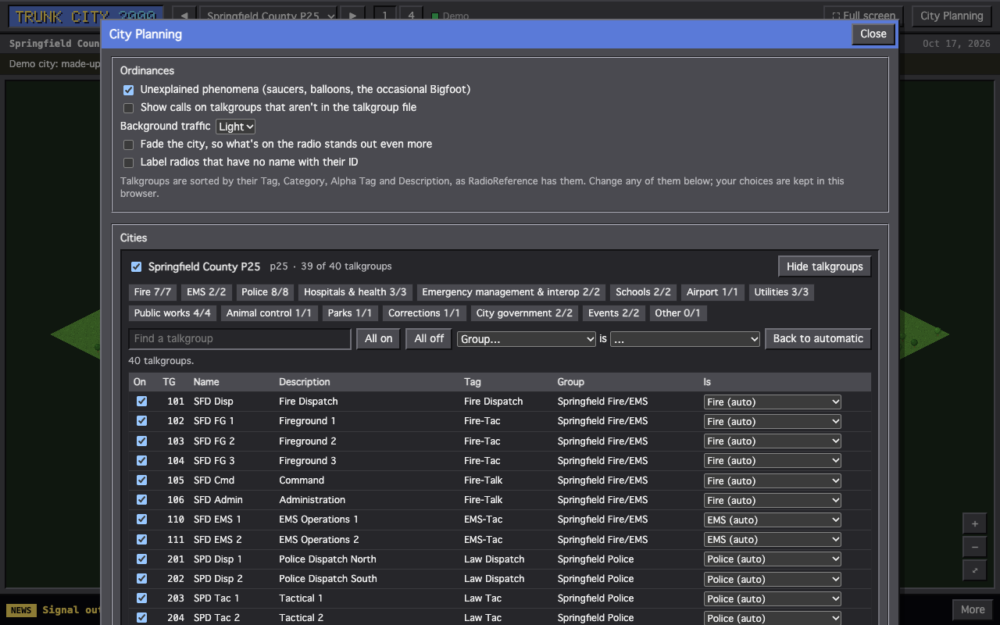

# Trunk City 2000

An isometric city for each radio system your
[Trunk Recorder Pro](https://github.com/TrunkRecorder/trunk-recorder-pro) records, built from its
talkgroups. Every call sends something out into town: a call on a fire talkgroup rolls an engine
and a ladder truck out of the fire station to a house fire, a kitten up a tree or a fender-bender;
a public works call sends a crew to patch a pothole; a bus talkgroup puts a bus on its route; a
rail talkgroup runs a train into the station. Now and then, for no reason at all, a flying saucer
comes for a cow.



It isn't what the calls are really about. Nobody here knows that, and an encrypted call says
nothing at all. It's something of the right kind, so the city is as busy as the radio is. It only
needs to know that a talkgroup is on the air, and which radio is talking, so encrypted talkgroups
count too.

## Getting it

In Trunk Recorder Pro, open **Interfaces**, find Trunk City 2000 in the store, and install it.
Before it's listed there, use **Install from GitHub…** with `TrunkRecorder/trunk-city-2000`, or:

```sh
trunk-pro interface install TrunkRecorder/trunk-city-2000
```

It asks for listen access only: it can see and play what the recorder shows, and change nothing.

## What you see

- **A city per system.** Its size follows the number of talkgroups: a small town for a dozen, a
  sprawl for a statewide system. Each kind of talkgroup gets its buildings: fire stations, police
  precincts, hospitals, a bus depot, a railway with stations, a public works yard with its salt
  dome, a water tower, an airport, a stadium, a jail, an armory. City Hall is in the middle. The
  radio tower blinks faster while anyone's talking. The same talkgroups always build the same city.
- **Every talkgroup has a home** in its city: hover over a building to see whose it is, with the
  talkgroups on the air right now marked. Little radio waves rise over buildings whose talkgroups
  are talking.
- **Every radio is someone in town.** The radio talking on a call (its unit ID, which the
  control channel gives even for encrypted calls) becomes a vehicle of its talkgroup's kind: a
  patrol car on a police talkgroup, an engine on a fire one (a ladder truck if it's called Truck,
  an ambulance if it's Medic), a bus, a plow, a jail van. It drives out from its talkgroup's
  building to whatever that talkgroup is busy with, and waits there. While it's transmitting it
  glows, with its name (its alias, from your unit names or heard on the air) in a bubble over
  it. Radios heard lately stay around for a couple of minutes, then drive home. Dispatchers are
  their buildings, which light up when they talk: a radio named like one (Dispatch, Console), or
  one that talks on three talkgroups in 15 minutes or keys up a dozen times in 10.
- **Calls set things going.** A talkgroup's first call starts something; the calls after it
  (dispatch, then units answering) keep it going; it winds down when the talkgroup has been quiet a
  while. A tactical talkgroup joins whatever its dispatch started. A sign floats over each one,
  blinking while it's on the air. Its radios are its responders; on a system that doesn't say who's
  talking, stand-ins go instead.
- **What's on the radio stands out,** in each service's color (blue police, orange fire, pink
  EMS, green transit, amber public works…). Every radio's vehicle has a ring on the ground under
  it, faint while it's been heard lately and pulsing while it talks, so it's never mistaken for
  traffic. A radio that's talking leaves a trail of sparkles, and shows through any building it's
  behind. One on its way to an incident shows its route: dots marching along the streets to a
  ring where it's going. A dispatcher's building glows, with rays turning over it and radio rings
  rising from its roof. Bubbles carry the service's color down their side. Background traffic is
  light: a few cars, no buses or trains but the radio's.
- **The news.** The ticker at the bottom has the latest headline; **More** opens the paper.
- **Four at once.** **4** shows up to four cities side by side; the arrows on each one change which
  city it shows. Double-click a city to open it on its own.
- **Unexplained phenomena:** saucers, hot-air balloons, the blimp, geese, ducks crossing, a sleigh in
  December, and an occasional blurry Bigfoot. Turn them off in City Planning if you must.



Drag to move around, scroll or pinch to zoom, and **⤢** to see the whole city. The zoom is smooth,
and the art is drawn at whatever size it's shown, so it's sharp up close, and the closer you look
the more there is: siding and shingles, window sills, wheels, a clock on the school, the crowd in
the stands.

**🎥 Follow** hands the camera over: it flies to the radio that's on the air, pulling out and
back in when it's across town, follows it while it talks, and cuts to the next one to key up;
when everyone's quiet it pulls back to where they've been. A caption at the bottom says who it is
and on what talkgroup. With **🔊 Listen** on, it goes to the radios you're hearing. Move the camera
yourself and it waits a few seconds before taking over again. It's made for a wall or a spare
monitor, in full screen.

**⛶ Full screen** fills the screen with the city, or the four, for a wall or a spare monitor.
After a few seconds without a move, the bars and the pointer step aside; move the mouse or press a
key and they're back.

| Key | |
|---|---|
| ← → | The previous / next city |
| 1, 4 | One city, four cities |
| + − 0 | Zoom in, out, fit |
| C | Follow whoever's talking |
| F | Full screen |
| U | Summon a saucer |

**🔊 Listen** plays live audio from the city (or cities) on screen, for the talkgroups that are on.

## How talkgroups are sorted

A city is only as good as its talkgroup file, so it works with systems whose talkgroups say what
they are: files exported from [RadioReference](https://www.radioreference.com), with their **Tag**
(the service type: Law Dispatch, Fire-Tac, Public Works…) and **Category** (the group). Systems
where most talkgroups land nowhere in particular start turned off.

Each talkgroup is scored on all four columns:

- **Tag:** the best guide for police, fire, EMS, hospitals, schools, corrections, utilities and the
  military. It counts for less when it's a catch-all: RadioReference's "Public Works" covers nearly
  everything a government runs that isn't an emergency (parks, animal control, airports,
  elections, libraries), and "Interop" covers patches and special-event channels.
- **Alpha Tag and Description:** words beat a catch-all tag, so "Parks and Recreation" under Public
  Works is parks. Squeezed words are pulled apart ("538DPW" is DPW, "TrainOpsBlue" is train ops), and
  words like TAC, OPS and ADMIN decide nothing on their own.
- **Category:** counts for a little, since a department's group holds all kinds of talkgroups.
- A few small kinds win over the tag that hides them: animal control filed under Law Tac, a jail
  channel under the sheriff, a school bus under Transportation, an event channel under Interop.

The rules came from a survey of 40,415 talkgroups on 48 RadioReference systems: statewide networks
(Michigan MPSCS, Ohio MARCS, Minnesota ARMER, Colorado DTRS…), counties and cities from DC to San
Diego, and transit, airport and school systems. Where the tag says which service a talkgroup is,
the result agrees with it 87% of the time. Most of the other 13% are deliberate: event pools,
parks, water, animal control and government talkgroups that RadioReference files under catch-all
tags. The cases that taught it are in [test/classify.test.mjs](test/classify.test.mjs).

Data, test and spare talkgroups start off.

## City Planning

**City Planning** (top right) is where you change any of that:

- turn systems on and off;
- open a system's talkgroups: turn each one on or off, or say what it is. The buttons at the top
  filter by kind; **All on**, **All off** and **Back to automatic** act on the talkgroups shown, and
  *Group … is …* sets a whole group at once (a transit agency's "Rail Maintenance" group, say);
- choose whether calls on talkgroups that aren't in the file count;
- set the background traffic (none, light or busy), whether the city is faded so the radio
  stands out even more (off unless you turn it on), and whether radios with no name are labeled
  with their ID.

Your choices are kept in this browser, not in the recorder. Each browser, and each person, has
their own.



## Try it without a recorder

Add `?demo` to the address for a demo with four made-up systems, a county, a transit agency, a
small city and a harbor, and calls coming and going on them.

## Working on it

The page is plain HTML, CSS and JavaScript modules: no build step, nothing from the internet.
Every picture, from the tiles and buildings to the fire trucks and the cows, is drawn in code as
vector art ([interface/js/sprites.js](interface/js/sprites.js), with the isometric boxes, roofs
and cylinders of [interface/js/vec.js](interface/js/vec.js)), with more detail the larger it's
drawn. No art is borrowed from other games.

| File | |
|---|---|
| `interface/js/app.js` | The page: systems, views, calls to cities, the ticker |
| `interface/js/classify.js` | What each talkgroup is |
| `interface/js/citygen.js` | A city from a system's talkgroups |
| `interface/js/city.js` | Drawing a city and everything moving in it |
| `interface/js/scenarios.js` | What each kind of call sets going, and the headlines |
| `interface/js/sprites.js`, `vec.js` | The art, and drawing it in three dimensions |
| `interface/js/pixel.js` | Colors, and the logo's bitmap font |
| `interface/js/panel.js` | City Planning |
| `interface/js/demo.js` | The demo's pretend recorder |

To run it against a recorder, with listen access whatever the recorder's port allows:

```sh
node tools/serve.mjs --recorder 127.0.0.1:8080     # then open http://localhost:8099/
```

Or serve it from the recorder itself, which reads the files on every request:

```sh
trunk-pro --ui ./interface
```

Tests (Node 22 or later):

```sh
node --test test/*.test.mjs
```

`node tools/shoot.mjs <url> <file.png>` runs the page in headless Chrome and saves a screenshot,
printing anything the page logs; `--count 4 --every 2` takes several, to see things move. The
screenshots in `interface/screenshots/` come from the demo; `--scale 2` takes them at twice the
resolution. `tools/occlusion.js` checks, pixel for pixel, that buildings hide what's behind them
(how to run it is at its top).

Releasing works as in the
[interface template](https://github.com/TrunkRecorder/trunk-interface-template#releasing): set
`version` in `interface/interface.json`, add a section to [CHANGELOG.md](CHANGELOG.md), then tag
`v<version>` and push the tag.

## License

MIT. Trunk City 2000 is a fan's tribute to the city builders of the early nineties. It isn't
affiliated with or endorsed by the makers of any of them.
